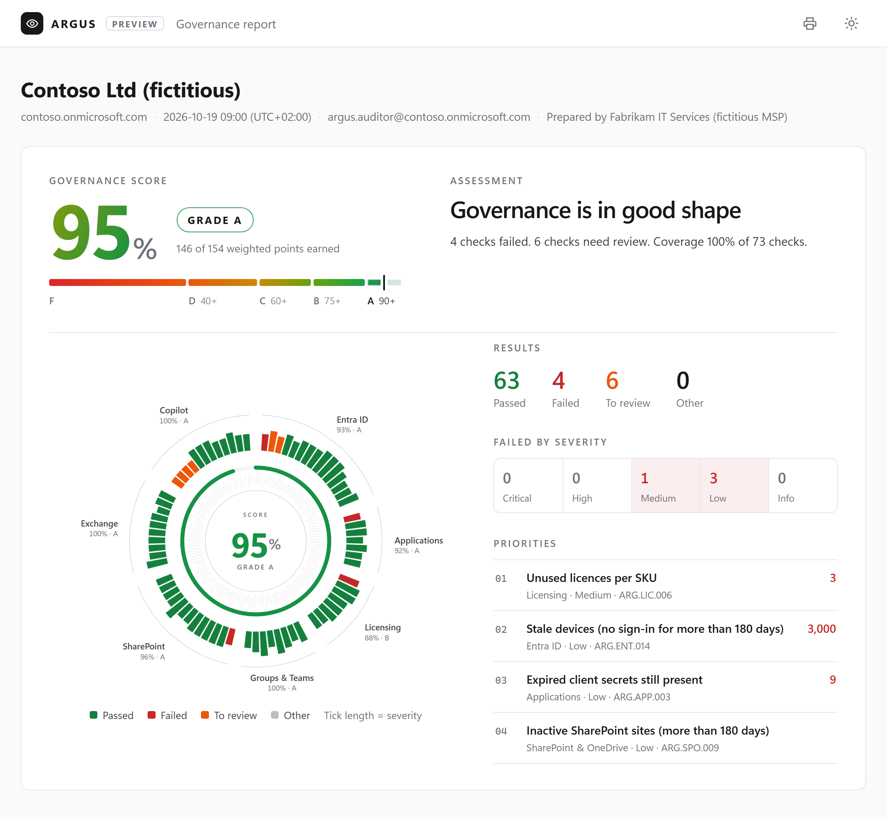

<p align="center">
  <picture>
    <source media="(prefers-color-scheme: dark)" srcset="docs/assets/argus-logo-dark.svg">
    
  </picture>
</p>

<h3 align="center">Automated Report &amp; Governance Utility Suite</h3>

<p align="center">
  Read-only governance assessment for Microsoft 365: 73 checks, a weighted Governance Score<br>
  and a self-contained HTML report that explains every finding and how to fix it.
</p>

<p align="center">
  <a href="https://www.powershellgallery.com/packages/ARGUS"></a>
  <a href="https://www.powershellgallery.com/packages/ARGUS"></a>
  <a href="https://github.com/dbianchi02/M365-ARGUS/actions/workflows/ci.yml"></a>
  <a href="https://github.com/dbianchi02/M365-ARGUS/releases/latest"></a>
  <br>
  
  
  
  <a href="https://github.com/dbianchi02/M365-ARGUS/discussions"></a>
  <a href="LICENSE"></a>
</p>

<p align="center">
  <a href="#quick-start">Quick start</a> ·
  <a href="docs/checks/README.md">Check catalogue</a> ·
  <a href="https://github.com/dbianchi02/M365-ARGUS/releases/latest">Sample report</a> ·
  <a href="CHANGELOG.md">Changelog</a> ·
  <a href="https://github.com/dbianchi02/M365-ARGUS/discussions">Discussions</a>
</p>

ARGUS is a PowerShell module that runs **read-only governance checks** against a Microsoft 365 tenant, computes a weighted **Governance Score** and produces a self-contained **HTML report** (plus JSON and optional CSV) listing every check, what was found and how to fix it.

<p align="center">
  <picture>
    <source media="(prefers-color-scheme: dark)" srcset="docs/assets/argus-report-dark.png">
    
  </picture>
</p>

A demo report of a fictitious tenant is attached to every [release](https://github.com/dbianchi02/M365-ARGUS/releases/latest) (`showcase-report.html`) and kept in [`samples/`](samples/showcase-report.html): download it and open it in a browser.


## What ARGUS is

- A **governance / hygiene** assessment of 73 checks across Entra ID, app registrations, licensing, Microsoft 365 Groups & Teams, SharePoint & OneDrive, Exchange Online and Copilot & agents.
- **Strictly read-only**: it never writes, updates or deletes anything in the tenant. Remediation is text and sample code in the report, never executed.
- Cross-platform: PowerShell 7.2+ on Windows, macOS and Linux.
- Lightweight: only `Microsoft.Graph.Authentication` is required. `ExchangeOnlineManagement`, `PnP.PowerShell` and `MSCommerce` are optional; checks that need a missing module or connection are reported as **Skipped** with the reason, never as errors.
- A single HTML file with no external dependencies (no CDN, no web fonts), light and dark mode, printable as PDF.

## What ARGUS is not

- **Not a security baseline**: no CIS / CISA / MFA / Conditional Access / Defender checks. Use dedicated tools (for example [Maester](https://maester.dev)) for that.
- **Not a remediation tool**: it tells you what to change; you decide and apply it.

## Requirements

| Component | Needed for | Notes |
|---|---|---|
| PowerShell 7.2+ | everything | Windows, macOS or Linux |
| `Microsoft.Graph.Authentication` 2.0+ | all Graph checks | installed automatically with ARGUS |
| `ExchangeOnlineManagement` 3.7.2+ | Exchange checks, shared-mailbox detection | optional |
| `PnP.PowerShell` 2.x+ | classic site administrators, site sharing and labels, private site URLs | optional, needs its own app registration (`-ClientId`) |
| `MSCommerce` | Copilot self-service purchase policies | optional, interactive sign-in on Windows only |

Some checks need a licence in the tenant (Entra ID P1/P2 for sign-in activity, Microsoft 365 Copilot for Copilot usage); without it they are Skipped.

## Installation

```powershell
Install-Module ARGUS -Scope CurrentUser
# Optional, for the Exchange Online and SharePoint checks
Install-Module ExchangeOnlineManagement, PnP.PowerShell -Scope CurrentUser
# Optional, Windows only, for the Copilot self-service purchase check
Install-Module MSCommerce -Scope CurrentUser
```

## Quick start

```powershell
Connect-Argus -Service All -ClientId <PnP app client id>   # see "First run, step by step" for the client id
Invoke-Argus                                               # runs every check, writes HTML + JSON to ./output and opens the report
```

Without `-Service All -ClientId` ARGUS connects Microsoft Graph only: the Exchange Online and SharePoint (PnP) checks are then reported as Skipped.

## First run, step by step

The steps below are the path ARGUS has been validated on: an interactive run signed in as a **Global Administrator**. Steps 1 and 2 are done once per tenant.

### 1. Show real names in the usage reports

Inactivity and storage checks read the Microsoft 365 usage reports. If the tenant conceals names in them, those checks return **To review** and the report shows a banner, because hashed names cannot be matched.

In the [Microsoft 365 admin center](https://admin.microsoft.com) go to **Settings › Org settings › Services › Reports** and clear **Display concealed user, group, and site names in all reports**. The change can take a few minutes to apply; you can turn it back on after the assessment.

### 2. Create the app registration for PnP.PowerShell

PnP.PowerShell needs an Entra ID app registration of your own for interactive sign-in (Graph and Exchange Online use Microsoft's apps and need nothing). Create it once with PnP itself, signed in as a Global Administrator:

```powershell
Register-PnPEntraIDAppForInteractiveLogin -ApplicationName 'ARGUS PnP' -Tenant contoso.onmicrosoft.com
```

A browser window asks you to sign in and to consent; at the end the cmdlet shows the app's **client ID** (also visible in Entra ID › App registrations). That is the value for `-ClientId`.

> [!NOTE]
> With no permission parameters PnP grants its default delegated permissions (`AllSites.FullControl`, `Group.ReadWrite.All`, `User.ReadWrite.All`, `TermStore.ReadWrite.All`). ARGUS only calls read cmdlets (`Get-PnPTenantSite`, `Get-PnPTenant`) and delegated access is always limited by the roles of the signed-in user, but you may prefer a narrower app. A read-oriented registration such as `-SharePointDelegatePermissions AllSites.Read -GraphDelegatePermissions Group.Read.All` has not been validated with ARGUS yet: if you try it, please share the result in [Discussions](https://github.com/dbianchi02/M365-ARGUS/discussions).

### 3. Connect

```powershell
Connect-Argus -Service All -ClientId <client id from step 2>
```

You sign in up to four times, once per service: Microsoft Graph, Exchange Online, SharePoint (PnP) and, on Windows, Commerce.

The first time in a tenant, Microsoft Graph shows a consent prompt for **Microsoft Graph Command Line Tools** listing the read-only permissions ARGUS needs. Tick **Consent on behalf of your organization** and accept. Admin consent can be granted by a Global Administrator, Application Administrator or Cloud Application Administrator.

### 4. Check what will run

```powershell
Test-ArgusPrerequisite
```

It lists missing modules, connections, permissions and licences, and which checks would be skipped and why.

### 5. Run the assessment

```powershell
Invoke-Argus
```

A tenant with a few hundred users takes one to two minutes. When the run ends, the HTML report opens in your browser (`-NoBrowser` to skip it). Close the sessions with `Disconnect-Argus` when you are done.

### Output files

Every run writes to `./output` (or the folder given with `-OutputPath`, created if missing):

| File | Content |
|---|---|
| `ARGUS-Report-<tenant>-<yyyyMMdd-HHmm>.html` | The report: one self-contained file (styles and scripts included), ready to share or print to PDF. |
| `ARGUS-Report-<tenant>-<yyyyMMdd-HHmm>.json` | All results, for automation, comparisons over time, or `Export-ArgusReport` to re-render the HTML. |
| `ARGUS-Report-<tenant>-<yyyyMMdd-HHmm>-<check id>.csv` | Only with `-OutputFormat Html, Json, Csv`: the findings of each failed check. |

An existing folder is reused and earlier reports are kept, so you build a history per tenant. Remediation scripts are sample code inside the report, never separate files and never executed.

> [!IMPORTANT]
> Reports contain tenant data (user names, groups, sites). Store and share them like any other confidential customer document.

### Roles and least privilege

All runs so far used a **Global Administrator**, which covers every check. For a least-privilege account:

| Area | Role needed (delegated) |
|---|---|
| Entra ID, applications, licensing, groups, tenant settings | Global Reader |
| Usage reports (inactive sites, Teams, mailboxes, OneDrive, Copilot licences) | Reports Reader (or Global Reader) |
| Exchange Online | Global Reader, or the View-Only Organization Management role group |
| SharePoint (PnP) | SharePoint Administrator or Global Reader |
| Copilot web search policy, agent catalogue (ARG.COP.006, 011, 012) | AI Administrator |
| Copilot enhanced personalization (ARG.COP.007) | Global Administrator |

Checks whose data the account cannot read are reported as **Skipped** with the reason; they never stop the run. `Get-ArgusRequiredPermission -Id <check id>` shows what a single check needs.
## Common options

```powershell
Invoke-Argus -Area EntraID, Licensing                     # only some areas
Invoke-Argus -Id ARG.SPO.009, ARG.SPO.010                 # only some checks
Invoke-Argus -ExcludeId ARG.EXO.008 -OutputFormat Html, Json, Csv -NoBrowser
Invoke-Argus -ConfigPath ./contoso.config.json -OutputPath ./reports
$result = Invoke-Argus -PassThru -NoBrowser -NoBanner     # results object for scripting

Export-ArgusReport -InputPath ./output/ARGUS-Report-contoso-20261021-1144.json   # re-render the HTML from JSON
```

## Troubleshooting

| Symptom | Cause and fix |
|---|---|
| Inactivity checks show **To review** and a banner about concealed names | Usage reports conceal names: see [step 1](#1-show-real-names-in-the-usage-reports). |
| Warning *SharePoint (PnP) was not connected* | `-ClientId` is missing or wrong, PnP.PowerShell is not installed, or the admin URL could not be derived (pass `-SharePointAdminUrl https://contoso-admin.sharepoint.com`). The SharePoint checks that need PnP are then Skipped or partial. |
| Exchange Online sign-in fails or hangs | Update ExchangeOnlineManagement to 3.7.2 or later; ARGUS signs in through the browser (`-DisableWAM`) to avoid the WAM error in PowerShell 7 terminals. |
| ARG.COP.001 is Skipped | The Commerce connection (MSCommerce) is available only for interactive sign-in on Windows. |
| A check is Skipped for a missing licence | The tenant has no licence for that feature (for example Entra ID P1 for sign-in activity, Microsoft 365 Copilot): expected. |
| A check is Skipped for a missing role or permission | The signed-in account cannot read that data: see [Roles and least privilege](#roles-and-least-privilege). |
| Some site URLs are empty in ARG.SPO.009 or ARG.SPO.010 | Private group and channel sites can be read only through PnP: connect SharePoint (`-Service All -ClientId`). |

Run a single check with details to see what happens: `Invoke-Argus -Id <check id> -Verbose`. Still stuck? Ask in [Discussions › Q&A](https://github.com/dbianchi02/M365-ARGUS/discussions/categories/q-a).

## Updating and uninstalling

```powershell
Update-Module ARGUS                      # latest version
Get-InstalledModule ARGUS -AllVersions   # installed versions
Uninstall-Module ARGUS -AllVersions      # remove ARGUS
```

Reports in `./output` are not touched by updates or uninstall.
## Unattended runs (app-only)

> [!WARNING]
> App-only sign-in (certificate or managed identity) is implemented but has not been validated on a production tenant during the preview. Interactive runs are the supported path for now.

```powershell
# Certificate
Connect-Argus -TenantId contoso.onmicrosoft.com -ClientId <app id> -CertificateThumbprint <thumbprint> -Service Graph, Exchange, SharePoint
# Managed identity (Azure Automation, Azure Functions, VMs)
Connect-Argus -ManagedIdentity
Invoke-Argus -NoBrowser -NoBanner
```

The app registration needs the Microsoft Graph **application** permissions listed by `Get-ArgusRequiredPermission -Aggregate -AsAppPermission`, granted by a Privileged Role Administrator or Global Administrator. For Exchange Online add `Exchange.ManageAsApp` and the Entra role Global Reader to the app. The Commerce checks are not available app-only.

## Permissions

All permissions are read-only. The exact list per check, or aggregated, comes from the check metadata:

```powershell
Get-ArgusRequiredPermission -Aggregate                     # what Connect-Argus requests (delegated)
Get-ArgusRequiredPermission -Aggregate -AsAppPermission    # for an app registration
Get-ArgusRequiredPermission -Id ARG.ENT.001                # one check
```

Microsoft Graph scopes in the full catalogue: `Application.Read.All`, `AuditLog.Read.All`, `CopilotPackages.Read.All`, `CopilotPolicySettings.Read`, `Device.Read.All`, `Directory.Read.All`, `Group.Read.All`, `GroupMember.Read.All`, `GroupSettings.Read.All`, `LicenseAssignment.Read.All`, `Organization.Read.All`, `PeopleSettings.Read.All`, `Policy.Read.All`, `Reports.Read.All`, `ReportSettings.Read.All`, `RoleEligibilitySchedule.Read.Directory`, `RoleManagement.Read.Directory`, `SharePointTenantSettings.Read.All`, `Sites.Read.All`, `User.Read.All`.

Exchange Online: Global Reader or the View-Only Organization Management role group.

## Governance Score

Each check has a severity weight (Critical 10, High 5, Medium 3, Low 1, Info 0). Passed checks get full credit, *To review* half credit, Failed none; Skipped, Error and Not run checks are left out.

`Score = round(100 × Σ(weight × credit) / Σ(weight of evaluated checks))`, also computed per area. Grades: A ≥ 90, B ≥ 75, C ≥ 60, D ≥ 40, F < 40. When less than 70 % of the selected weight could be evaluated, the score is labelled *Partial*.

## Configuration

`New-ArgusConfig -Path ./contoso.config.json` writes the defaults. You can set global exclusions (for example emergency-access accounts), per-check parameters, severity or `Enabled`, scoring weights and report branding:

```json
{
  "Exclusions": { "UserPrincipalNames": ["breakglass01@contoso.onmicrosoft.com"], "ObjectIds": [], "GroupIds": [], "SiteUrls": [], "AppIds": [] },
  "Checks": { "ARG.ENT.001": { "Enabled": true, "Parameters": { "InactiveDays": 60 }, "Severity": "High" } },
  "Scoring": { "Weights": { "Critical": 10, "High": 5, "Medium": 3, "Low": 1, "Info": 0 }, "InvestigateCredit": 0.5 },
  "Report": { "MaxFindingsInHtml": 500, "CompanyName": "Contoso IT", "LogoPath": "./logo.png" }
}
```

## Check catalogue

| Area | Checks | Examples |
|---|---|---|
| Entra ID (`ARG.ENT`) | 15 | inactive members and guests, guests without sponsor, break-glass accounts, Global Administrator count, stale devices |
| Applications (`ARG.APP`) | 7 | app registrations without owners, expiring or long-lived secrets and certificates |
| Licensing (`ARG.LIC`) | 8 | licences on disabled or inactive users, overlapping licences, unused licences per SKU |
| Groups & Teams (`ARG.GRP`) | 8 | group creation, naming and expiration policies, ownerless groups and Teams, inactive Teams |
| SharePoint & OneDrive (`ARG.SPO`) | 13 | sharing defaults, Anyone links, orphaned and inactive sites, storage quotas, OneDrive of departed users |
| Exchange Online (`ARG.EXO`) | 10 | shared mailboxes with sign-in, inactive mailboxes, forwarding, distribution groups without owner |
| Copilot & agents (`ARG.COP`) | 12 | self-service purchase and trials, unused Copilot licences, web search, agent sharing and requests |

The full catalogue, with one page per check (what is checked, why it matters, how to fix it, permissions, parameters and references), is in [docs/checks](docs/checks/README.md). `Get-ArgusCheck` returns the same metadata in PowerShell.

## Custom checks

Checks are discovered from the built-in `Checks/` folder and from any folder passed with `-CustomCheckPath`. A check is one `.ps1` file that calls `Register-ArgusCheck` with its metadata and a `Test` script block returning `New-ArgusResult`; use any built-in check as a template, and see §4 of the [specification](docs/ARGUS-SPEC.md) for the full contract. Custom checks must stay read-only.

```powershell
Invoke-Argus -CustomCheckPath ./my-checks
```

## Development

```powershell
./build/build.ps1 -Task Lint      # PSScriptAnalyzer
./build/build.ps1 -Task Test      # Pester (Graph fully mocked)
./build/build.ps1 -Task Docs      # regenerate docs/checks from the check metadata
./build/build.ps1 -Task Sample    # regenerate samples/sample-report.html from fixtures
./build/build.ps1 -Task Package   # stage the module for publishing
```

See [CONTRIBUTING.md](CONTRIBUTING.md), the [CHANGELOG](CHANGELOG.md) and the full specification in [docs/ARGUS-SPEC.md](docs/ARGUS-SPEC.md).

## Community and support

- **Questions and ideas**: [Discussions](https://github.com/dbianchi02/M365-ARGUS/discussions) (Q&A, Ideas, Show and tell).
- **Bugs and check requests**: [Issues](https://github.com/dbianchi02/M365-ARGUS/issues/new/choose), using the templates.
- **Vulnerabilities**: privately, as described in [SECURITY.md](SECURITY.md).
- **Contributing**: read [CONTRIBUTING.md](CONTRIBUTING.md); everyone taking part follows the [Code of Conduct](CODE_OF_CONDUCT.md).

Please never post real tenant data, reports or screenshots from a real tenant in issues or discussions. See [SUPPORT.md](SUPPORT.md) for where to ask what.

## Disclaimer

ARGUS is provided "as is", without warranty of any kind. Findings depend on the permissions and licences available to the account that runs it; review them before acting. ARGUS is not affiliated with or endorsed by Microsoft.

## License

[MIT](LICENSE) © 2026 Davide Bianchi
